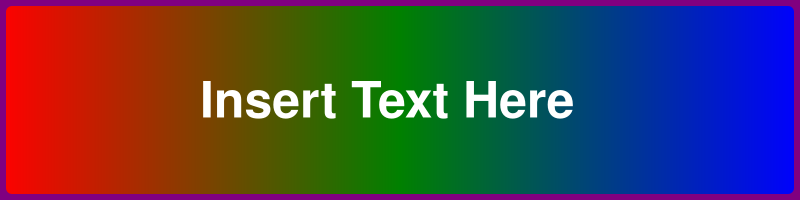
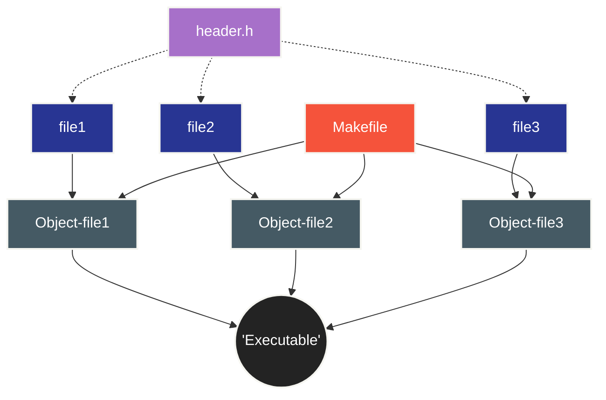

<p align="center">

</p>

<br />

<div align="center">

<a href="" target="_blank" rel="noopener">
  
</a>

</div>

<br />
<br />
<br />
<br />
<br />
<br />

<div align="center">

# Project Title/Name

<br />


<br/>

*"Image legend"*

</div>

<br />
<br />

<div align="center">

## {🗂️}\ Summary

<br />

<h3>
  <a href="#context" style="text-decoration: none;">
    <kbd style="font-size: 0.9em; padding: 0.3em 0.6em; font-weight: bold;">Context</kbd>
  </a>
</h3>


<br />

<h3>
  <a href="#guide" style="text-decoration: none;">
    <kbd style="font-size: 0.9em; padding: 0.3em 0.6em; font-weight: bold;">Guide</kbd>
  </a>
</h3>

<br />

<h3>
  <a href="#more-information" style="text-decoration: none;">
    <kbd style="font-size: 0.9em; padding: 0.3em 0.6em; font-weight: bold;">More Information</kbd>
  </a>
</h3>

<br />

<h3>
  <a href="#download" style="text-decoration: none;">
    <kbd style="font-size: 0.9em; padding: 0.3em 0.6em; font-weight: bold;">Download</kbd>
  </a>
</h3>

<br />

<h3>
  <a href="#future" style="text-decoration: none;">
    <kbd style="font-size: 0.9em; padding: 0.3em 0.6em; font-weight: bold;">Future</kbd>
  </a>
</h3>

<br />

<h3>
  <a href="#credits" style="text-decoration: none;">
    <kbd style="font-size: 0.9em; padding: 0.3em 0.6em; font-weight: bold;">Credits</kbd>
  </a>
</h3>

<br />
<br />

> Clickable Buttons !

</div>

<br />
<br />


<div align="center">

<h2 id="context">{📚}\ Context</h2>

</div>

<br />

> ---
>
> "Text".
>
> ---

<br />

<div align="center">


<br />

*"Image legend"*


<br />
<br />

<h2 id="guide">{📖}\ Guide</h2>

</div>

<br />

> <a href="" target="_blank" rel="noopener">
>  
> </a>
> <br>
> <br>
> 
> "Text".

```Language Type
code
```

<br />
<br />
<br />
<br />

> <a href="" target="_blank" rel="noopener">
>  
> </a>
> <br>
> <br>
> 
> "Text".

``` Language Type
code
```

<br />
<br />
<br />
<br />

<div align="center">

<h2 id="more-information">{🗞️}\ More Information</h2>

<em>"Text".</em>

<br />

</div>

> ---
> 
> "Text".
> 
> ---

> [!NOTE]
> "Text".

<br />
<br />

> [!WARNING]
> "Text".

<br />
<br />
<br />

<div align="center">

<h2 id="download">{📥}\ Download</h2>

</div>

<br />

> ---
>
> #### Prerequisites:
> **Make sure** you have **installed** on your **system**:
>
> <br>
> 
> <a href="" target="_blank" rel="noopener">
>   
> </a>
>  and
> <a href="" target="_blank" rel="noopener">
>   
> </a> 
> 
> <br>
> <br>
> <br>
> <br>
> 
> "Text":
>```bash
> command to copy
>```
>
> <br />
> <br />
> 
> "Text":
> 
>```bash
> command to copy
>```
>
> <br />
> <br />
> 
> The **project** can be directly downloaded on **GitHub**.
>
> ---

<br />
<br />
<br />

| File | Description | 
|:---:|:---:|
|**Makefile**| "Text".|
|**header.h**| "Text".|
| **file1** | "Text". |
| **file2** | "Text". |
|**file3**| "Text".|


<br />
<br />

```text
{🗂️}: Project_Repo/
|
├── [📁]Readme_assets/
│   └── *All the assets of the "[📖]/README.md"*
|
├── [⚙️]/Makefile
├── [🧩]/header.h
├── [📦]/package "(package.json in JavaScript for example)".
├── [📄]/file1
├── [📄]/file2
├── [📄]/file3
└── [📖]/README.md
```

<br />
<br />

<div align="center">



*"Project Composition"* 
This is an example of mindmap with flowchart for a project in language C.

</div>

<br />
<br />
<br />
<br />
<br />
<br />

<div align="center">

<h2 id="future">{🌌}\ Future</h2>

</div>

<br />

> ---
>
> "Text".
>
> ---

<br />
<br />
<br />
<br />
<br />
<br />

<div align="center">

<h2 id="credits">{📌}\ Credits</h2>

</div>

<br />

<p align="center">

<a href="https://github.com/EliasFCS" target="_blank" rel="noopener">
  
</a>

</div>